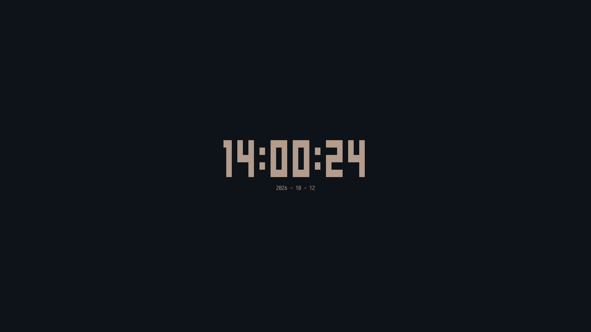

## Nock
### a full terminal clock built in rust (inspired by [tty-clock](https://github.com/xorg62/tty-clock.git))


### Dependencies
- cargo
- libnotify

### Installation

#### Build from source
```sh
git clone https://github.com/ochitsudayo/nock.git
cd nock
cargo build --release
```
then put the binary in your desired path

##### Nix
#### Running automatically with nix

```sh
nix run github:ochitsudayo/nock
```

#### Flake

First, add this to your flake inputs:

```nix
yum = {
    url = "github:ochitsudayo/nock";
    inputs.nixpkgs.follows = "nixpkgs";
};
```

Then pass to your outputs:

```nix
outputs = { nixpkgs, nock, ... }:
```

And install on your `environment.systemPackages`:

```nix
inputs.nock.packages.${pkgs.stdenv.hostPlatform.system}.default
```

### Usage

You can run nock without any argument and press keys while running to toggle functionalities

| Keymap | Description |
|-|-|
| c | toggles clock mode (default mode) |
| s | toggle seconds on clock mode |
| shift + c | toggle chronometer mote |
| t | toggle timer mode |
| space | start/pause/unpause both chronometer and timer |
| <1-8> | changes color (uses first 8 terminal colors) |
| up/down/left/right <br> hjkl | navigate on timer mode |
| ctrl + c | exit nock |

You can also use flags to customize nock's launch

| Flags | Description |
|-|-|
| -c <1-8> | runs with a specific color |
| -s | run alreadt showing seconds
| -t | start in timer mode |
| -C | start in chronometer mode |
| -v | show nock version |
| -h | show help message |
